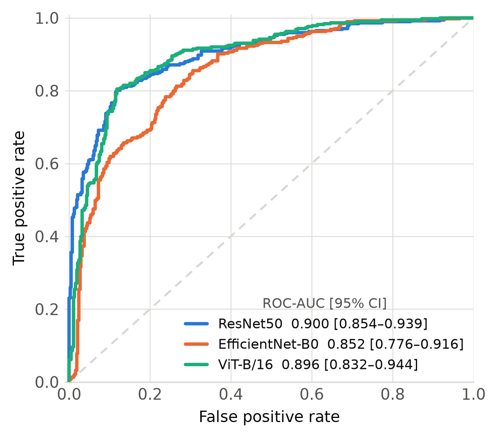
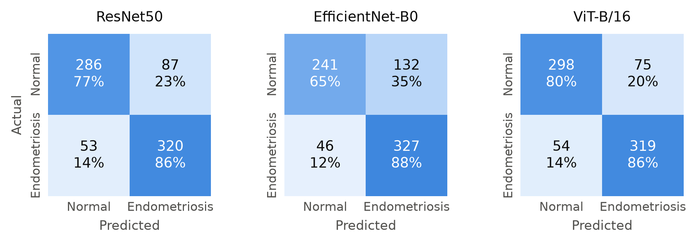
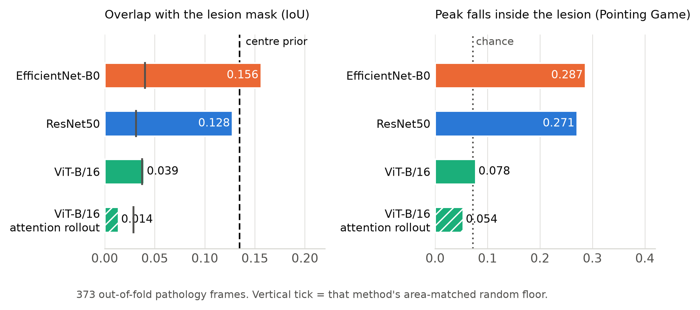
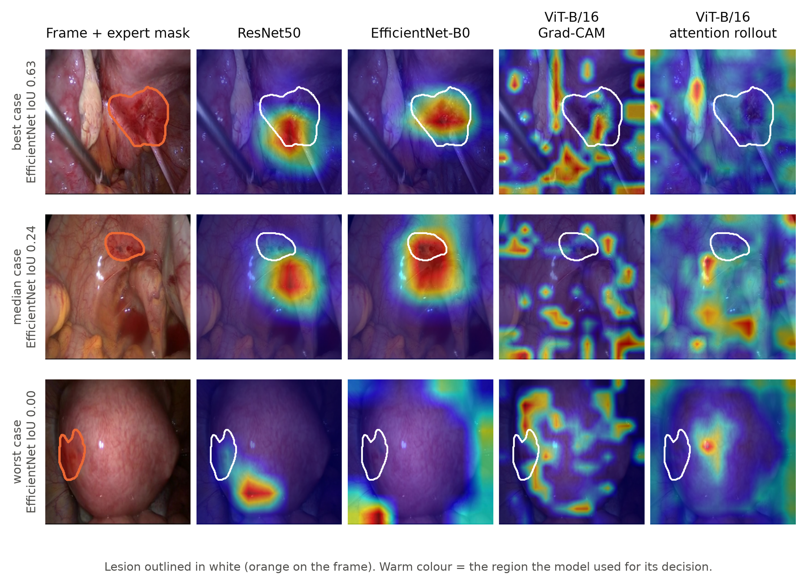

# Explainable Endometriosis Classification in Laparoscopic Images

**Comparing two CNNs against a Vision Transformer — and measuring whether their saliency maps actually land on the lesion.**

This project compares three ImageNet-pretrained models on binary endometriosis detection (endometriosis vs. no pathology) using still frames from the **GLENDA v1.5** laparoscopy dataset:

- **ResNet50** (CNN)
- **EfficientNet-B0** (CNN)
- **ViT-B/16** (Vision Transformer)

It also goes beyond accuracy. Every model's Grad-CAM map — and, for the transformer, **attention rollout** as well — is scored against the **373 expert lesion masks**, and against two reference levels that say what a map scores *without looking at the image*. Without those references an IoU number cannot be read at all.

> Status: experiments complete, manuscript in preparation. See [Roadmap](#roadmap).

---

## Key findings

Every number below comes from the current protocol: **5-fold cross-validation grouped by surgery**. All 746 frames of the balanced subset are partitioned by surgery (122 surgeries), each frame is predicted exactly once by the fold model that never saw its surgery, and all confidence intervals resample **surgeries, not frames** — frames from one recording share a patient, a camera and an illumination setting, so resampling frames would count repeated views of one case as independent evidence.

### Classification

| Model | Accuracy | Precision | Recall | F1 | ROC-AUC [95% CI] |
|---|---|---|---|---|---|
| **ResNet50** | 0.812 | 0.786 | 0.858 | 0.821 | **0.900 [0.854–0.939]** |
| EfficientNet-B0 | 0.761 | 0.712 | **0.877** | 0.786 | 0.852 [0.776–0.916] |
| ViT-B/16 | **0.827** | **0.810** | 0.855 | **0.832** | 0.896 [0.832–0.944] |

*Pooled out-of-fold over all 746 frames; 95% intervals from a 10,000-resample surgery-level bootstrap. Per-fold mean ± SD ROC-AUC: ResNet50 0.903 ± 0.082, EfficientNet-B0 0.884 ± 0.110, ViT-B/16 0.925 ± 0.052. Pooled confusion counts, out of 373 frames per class: ResNet50 TP 320 / FN 53 / FP 87 / TN 286; EfficientNet-B0 TP 327 / FN 46 / FP 132 / TN 241; ViT-B/16 TP 319 / FN 54 / FP 75 / TN 298. The evaluation set is balanced 1:1 while the source data are about 1:36, so accuracy and precision describe this balanced set only — not the predictive values a deployed model would reach at the prevalence of unselected frames.*

**Are the differences real? Mostly not.** After Holm correction within the family of three pairwise comparisons, the only classification difference this evaluation establishes is **ResNet50 over EfficientNet-B0**: ΔAUC +0.048 [+0.010, +0.095], *p* = 0.030. ResNet50 vs. ViT-B/16 shows no evidence of a difference (+0.004, *p* = 0.87). EfficientNet-B0 vs. ViT-B/16 favours ViT-B/16 but does not survive correction (−0.044, *p* = 0.058), so it is inconclusive rather than null. Frame-level McNemar tests look far more decisive on the same data (for example *p* = 7 × 10⁻⁵ for EfficientNet-B0 vs. ViT-B/16) — the discordant frames are concentrated in a few recordings, which is exactly what surgery-level resampling corrects for. Full numbers: [results/cv_analysis_summary.csv](results/cv_analysis_summary.csv), [results/cluster_bootstrap_classification.csv](results/cluster_bootstrap_classification.csv).

### Explanation quality vs. the expert masks

| Method | Mean IoU [95% CI] | Pointing Game [95% CI] | Coverage [95% CI] |
|---|---|---|---|
| **EfficientNet-B0**, Grad-CAM | **0.156 [0.133–0.180]** | **0.287 [0.233–0.347]** | 0.153 [0.128–0.181] |
| ResNet50, Grad-CAM | 0.128 [0.111–0.147] | 0.271 [0.221–0.324] | **0.168 [0.139–0.200]** |
| ViT-B/16, Grad-CAM | 0.039 [0.033–0.047] | 0.078 [0.052–0.105] | 0.070 [0.058–0.084] |
| ViT-B/16, attention rollout | 0.014 [0.010–0.019] | 0.054 [0.030–0.082] | 0.064 [0.051–0.078] |
| *Centred Gaussian prior* | *0.135* | *0.274* | *0.119* |
| *Map with no spatial information* | *area-matched* | *0.072* | *0.072* |

*All 373 pathology frames, from 102 surgeries, each scored by the fold model that never saw its surgery. Lesions occupy 7.20% of a frame on average (range 0.17–57.39%), which is why an uninformative map scores 0.072 on Pointing Game and Coverage by construction. For IoU — which grows with the area a method claims — each method is compared against a random region of exactly the area it claimed. The centred Gaussian encodes the "lesions are usually mid-frame" prior without looking at the image.*

**Are these differences real? Yes, decisively.** All six pairwise IoU differences survive Holm correction: EfficientNet-B0 exceeds ResNet50 by 0.029 (*p* = 0.004), both CNNs exceed ViT-B/16's Grad-CAM by 0.088 and 0.117 (*p* = 0.0006), and ViT-B/16's Grad-CAM exceeds its own attention rollout by 0.026 (*p* = 0.0006). Against the reference levels, **EfficientNet-B0 is the only model that beats the centre-of-image prior** (+0.022 IoU, *p* = 0.0048); ResNet50 is indistinguishable from that prior (*p* = 0.80); ViT-B/16's Grad-CAM is indistinguishable from area-matched random on IoU (*p* = 0.80) and from chance on both Pointing Game and Coverage (*p* = 1.00); attention rollout is worse still, falling below the random floor on IoU and below chance on Coverage. Full numbers: [results/cv_localization_summary.csv](results/cv_localization_summary.csv).

**Where the errors are.** They are not spread evenly. Of the 54 surgeries contributing at least five frames, the twelve with the highest error rate are predominantly no-pathology recordings; in the hardest of them (`v_4044`, 14 frames) each model misclassifies 11 to 13 frames, and 52 frames are misclassified by all three models. The dominant failure mode is a systematic false positive on healthy tissue in particular recordings, not missed lesions. Because the folds are grouped by surgery those frames were never trained on, so this is not memorisation; what distinguishes those recordings we do not claim to know. See [results/fig_error_clusters.png](results/fig_error_clusters.png).

**Takeaways**

1. **Classification does not separate the three architectures** at this sample size. Only ResNet50 over EfficientNet-B0 survives correction; the other two comparisons do not.
2. **Explanation quality does separate them, and in the opposite order.** EfficientNet-B0 — the one model this evaluation places *below* another on AUC — is the only one whose maps beat a centre-of-image prior. Ranking by discrimination and ranking by explanation quality disagree.
3. **ViT-B/16 classifies as well as ResNet50 here, but its explanations carry no detectable spatial signal**, and attention rollout does not repair that. The failure is therefore not simply an artefact of pointing a CNN-oriented method at a transformer.
4. **The protocol mattered more than the architecture.** Three protocols on the same data gave three orderings. A single case-wise held-out split of 107 frames ranked them ResNet50 0.915 / ViT-B/16 0.860 / EfficientNet-B0 0.833. An earlier cross-validation that grouped no-pathology frames by their per-*segment* folder let one recording land on both sides of a split, and put EfficientNet-B0 top at 0.913 pooled. Grouping by **recording** — the protocol reported here — drops EfficientNet-B0 to 0.852 and makes it the weakest model. The grouping unit has to be stated and justified, not assumed.

<p align="center">
  
  
</p>

<p align="center">
  
</p>

<p align="center">
  
</p>

> **Note on the overlay figure.** `fig_overlays.png` was generated from the earlier single-split model weights, so it is **illustrative only** — it does not come from the cross-validation run that every number on this page is based on. The quantitative localization results are `fig_localization.png` and [results/cv_localization_summary.csv](results/cv_localization_summary.csv).

The seven figures in `results/` are `fig_dataset_folds` (fold composition), `fig_roc_pooled`, `fig_confusion_pooled`, `fig_cv_auc` (each fold's AUC beside the pooled estimate and the old single-split value), `fig_localization`, `fig_overlays` (illustrative, see above) and `fig_error_clusters` (the hardest surgeries).

---

## Method

1. **Balanced subset.** GLENDA is very imbalanced: 373 pathology frames vs. 13,438 no-pathology frames (about 1:36). All 373 pathology frames are kept. 373 no-pathology frames are sampled **round-robin across the 27 no-pathology recording folders**, which avoids near-duplicate consecutive frames and single-recording dominance. `seed=42`. Total: **746 frames**.
2. **The group is the surgery.** Pathology frames carry a case id (`c_<id>`); no-pathology frames carry a recording-and-segment id. GLENDA stores no-pathology frames in per-segment folders, so one recording appears under several folder names — the segment suffix is stripped, because two segments of one recording are the same surgery. That leaves **122 surgeries** (102 pathology cases + 20 no-pathology recordings) spread over the 129 segment folders. Getting this wrong is what caused the leak described above.
3. **5-fold grouped cross-validation.** `StratifiedGroupKFold` with whole surgeries kept together; the training portion of each fold is split again group-wise for early stopping, so test portions are never used for model selection. It is asserted per fold that no group appears in two partitions and that the five test portions tile the dataset exactly once. Because groups are indivisible, fold composition varies: test portions hold 125–179 frames and pathology prevalence ranges from **37.8% to 66.4%** — which is why ROC-AUC, not accuracy, is the primary metric.
4. **Transfer learning.** ImageNet weights (ResNet50 `IMAGENET1K_V2`, the other two `IMAGENET1K_V1`), **full fine-tuning** with the head replaced by a 2-unit linear layer. Input 224×224, ImageNet normalisation. Adam, batch 32, learning rate 1e-4 for the CNNs and 2e-5 for ViT, up to 30 epochs with early stopping on validation ROC-AUC (patience 6) and best-epoch weights restored. Augmentation on train only: horizontal flip, ±15° rotation, brightness and contrast jitter 0.2. `seed=42` offset by fold index. 15 fits in total (3 architectures × 5 folds) on a single Colab T4.
5. **Evaluation.** The **pooled out-of-fold estimate is the primary result**; per-fold mean ± SD is reported as a description of between-fold variability, not as a second estimate of the same quantity. 10,000 bootstrap resamples, percentile intervals, surgery-level resampling, two-sided tests, Holm correction within each pre-specified family of comparisons.
6. **Explainability.** Grad-CAM at `layer4[-1]` (ResNet50), `features[-1]` (EfficientNet-B0) and the last encoder block's first layer-norm with a 14×14 token reshape (ViT-B/16); ViT-B/16 is additionally explained with attention rollout. Maps are normalised to [0, 1], upsampled to 224×224 and thresholded at 0.5, then scored against the lesion masks with IoU, the Pointing Game and Coverage — and against an area-matched random region and a centred Gaussian prior.

Fuller write-ups: [docs/research_brief.md](docs/research_brief.md) (the protocol and every headline number in one place) · [docs/methodology.md](docs/methodology.md) and [docs/literature_review.md](docs/literature_review.md) (early planning notes) · pipeline diagram: [diagrams/Methodology.drawio](diagrams/Methodology.drawio)

---

## Repository structure

```
├── scripts/
│   ├── prep_dataset.py              # builds the balanced, surgery-grouped dataset (+ lesion masks, manifest)
│   ├── analyze_cv.py                # fold composition, mean±SD, pooled out-of-fold metrics, paired tests
│   ├── cluster_bootstrap.py         # re-estimates every CI by resampling surgeries, not frames
│   ├── analyze_cv_localization.py   # out-of-fold explanation scores: means, CIs, Holm-corrected families
│   ├── localization_baselines.py    # area-matched random + centred-Gaussian reference levels
│   ├── vit_attention_rollout.py     # transformer-native explanations for ViT-B/16
│   ├── gradcam_per_image.py         # per-image Grad-CAM IoU / Pointing Game / Coverage (CPU)
│   ├── make_figures.py              # the paper figures
│   ├── make_overlay_figure.py       # the illustrative Grad-CAM overlay figure
│   └── check_paper_numbers.py       # checks every number in the manuscript against results/
├── notebooks/
│   ├── CrossValidation_5fold.ipynb  # Colab: the 5-fold surgery-grouped run (current protocol)
│   └── Endometriosis.ipynb          # Colab: the earlier single-split run, kept for the comparison
├── data/
│   └── manifest.csv                 # exact file → class → surgery → split assignment (reproducibility)
├── results/                         # metrics CSVs + the figures used in the paper
├── paper/                           # the manuscript
├── docs/                            # research brief + early planning notes
├── diagrams/                        # methodology pipeline (draw.io)
└── requirements.txt
```

## Reproducing

1. **Get the data.** Download GLENDA v1.5 from the [official source](https://ftp.itec.aau.at/datasets/GLENDA/) and put it in `Dataset/`:
   ```
   Dataset/Glenda_v1.5_classes/Glenda_v1.5_classes/{frames,annots}/
   Dataset/GLENDA_v1.5_no_pathology/no_pathology/frames/<video>/
   ```
2. **Build the balanced subset** (standard library only):
   ```bash
   python scripts/prep_dataset.py      # -> data/..., data/masks/, data/manifest.csv
   ```
   Zip `data/` as `glenda_balanced.zip`.
3. **Train, evaluate and explain.** Open `notebooks/CrossValidation_5fold.ipynb` in Google Colab with a T4 GPU, upload the zip, and run all cells. It performs the 15 fits, writes the per-frame out-of-fold predictions (`results/cv_predictions_v3.csv`, `results/cv_fold_metrics_v3.csv`) and scores the saliency maps inside the CV loop (`results/cv_localization_v3.csv`).
4. **Analysis (CPU, no GPU needed).** From those per-frame files:
   ```bash
   python scripts/analyze_cv.py              # -> results/cv_analysis_summary.csv, cv_analysis_pairwise.csv
   python scripts/cluster_bootstrap.py       # -> results/cluster_bootstrap_classification.csv
   python scripts/analyze_cv_localization.py # -> results/cv_localization_summary.csv
   python scripts/make_figures.py            # -> results/fig_*.png
   python scripts/check_paper_numbers.py     # checks the manuscript against the result files
   ```

> GPU training can differ slightly between runs because cuDNN is not fully deterministic, and the exact partition depends on the `StratifiedGroupKFold` implementation — running the same seed under a different scikit-learn version produced different folds. The frame-to-fold assignment is therefore released alongside the manifest, and the CPU analysis scripts above are deterministic with every bootstrap seeded (`seed=42`).

## Roadmap

- [x] Balanced, leakage-free dataset construction
- [x] CNN vs. ViT training and evaluation
- [x] Grad-CAM vs. ground-truth mask localization metrics
- [x] Chance-level and centre-prior reference levels for the localization metrics
- [x] 5-fold cross-validation grouped by surgery (the authoritative protocol)
- [x] Surgery-level (cluster) bootstrap for every confidence interval and paired test
- [x] Attention-rollout explanations for ViT-B/16
- [x] Per-frame out-of-fold predictions and error-concentration analysis
- [ ] Paper submission
- [ ] Occlusion experiment: how much performance does each architecture retain when the annotated lesion is hidden?

## Dataset and ethics

This work uses the public **GLENDA** dataset (Leibetseder et al., *GLENDA: Gynecologic Laparoscopy Endometriosis Dataset*, MMM 2020, [doi:10.1007/978-3-030-37734-2_36](https://doi.org/10.1007/978-3-030-37734-2_36)), released under **CC BY-NC 4.0**. No images are redistributed in this repository, except the Grad-CAM overlay figures made for the paper, which are shared non-commercially with attribution. The data is de-identified and public, so no extra IRB approval was needed.

*For research purposes only. Not a medical device. Nothing here is validated for clinical use: there is no calibration analysis, no decision-curve analysis, no external validation and no clinical evaluation.*

## Author

**Mozahid**, [@Mozahid-DIU](https://github.com/Mozahid-DIU)
